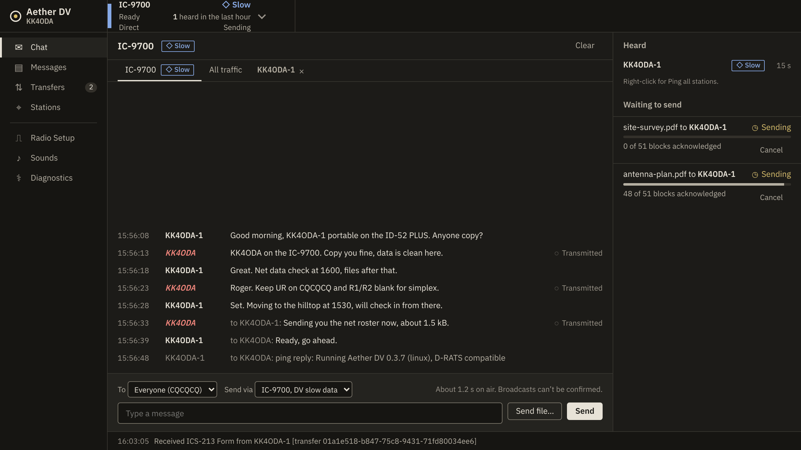
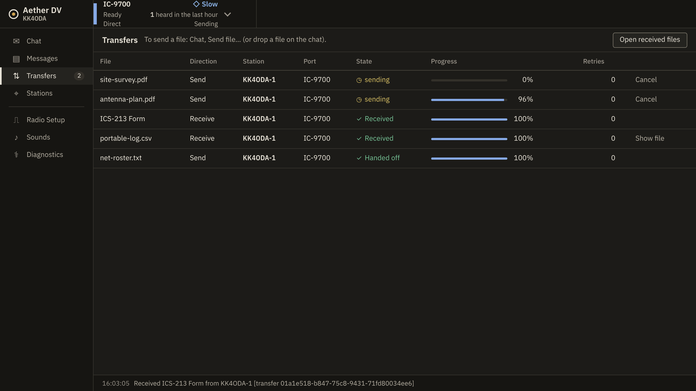
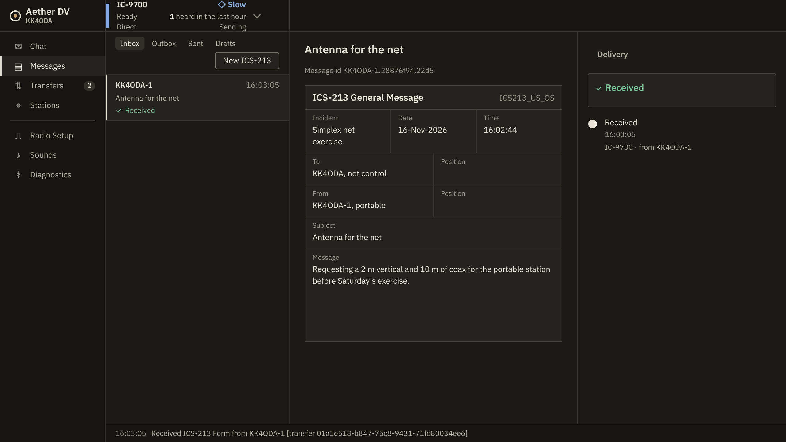
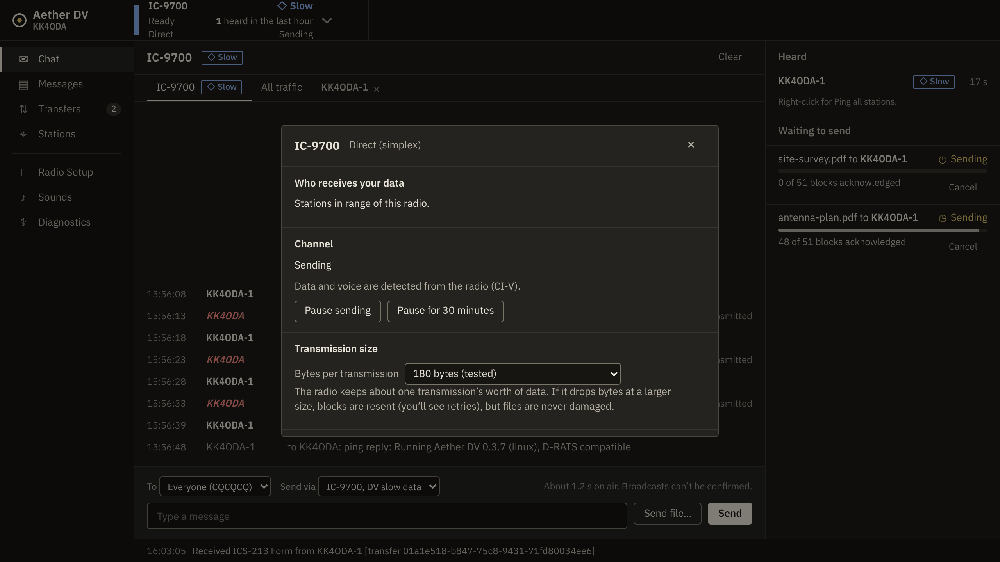

# Aether DV

An open-source D-STAR data communications application for amateur radio. It works alongside [D-RATS](https://github.com/ham-radio-software/D-Rats): it speaks the D-RATS protocol, so it can exchange chat, files and forms with D-RATS stations and use the same ratflectors. It adds Icom DV Fast Data and repeater-aware operation to conventional DV slow data.

Aether DV exists because of D-RATS and the people who built and maintain it; see [Acknowledgements](#acknowledgements).

> **Status: early releases (0.3.x, currently 0.3.7).** Bench-tested on an IC-9700 and an ID-52 PLUS on simplex. Not yet tested through repeaters or against running D-RATS stations. Results so far: [docs/bench-results.md](docs/bench-results.md).



## Download

Installers for Windows, macOS (Apple silicon) and Linux (.deb, .rpm, AppImage) are on the [releases page](https://github.com/KK4ODA/aether-dv-releases/releases/latest). The app checks for updates when it starts and offers to install them.

To connect a radio, see [Part A of the bench test guide](docs/bench-tests.md#part-a--preparation-once) and the example configurations for the [IC-9700](examples/ic9700.toml) and [ID-52 PLUS](examples/id52plus.toml). The app's **Radio Setup** view has step-by-step settings for each supported radio.

## What it does

**Chat**
- One tab per radio port, an All traffic tab, and a tab for each station you talk to directly.
- Send to **Everyone (CQCQCQ)** or to one station. Your own call sign is shown in red italics so your lines stand out.
- Queued lines can be cancelled before they go out. **Clear** hides a tab's history without deleting it.
- Right-click a station in **Heard** to ping it, ask its version, send it a file or open a conversation, or to **Ping all stations**.
- Keyboard: Enter sends, Ctrl+1 to Ctrl+9 switch tabs, Ctrl+L clears.

**Files**
- **Send file…** in Chat, or drop a file on the chat. Progress shows in blocks acknowledged by the other station.
- Transfers can be cancelled. Received files go to *Documents/Aether DV/Received*, with a **Show file** button for each.

**Messages**
- ICS-213 general messages, compatible with D-RATS forms, with inbox, outbox, sent and drafts, and a delivery timeline for each message.

**Radio and channel**
- **DV slow data** tuned on real radios: Aether DV honours the radio's XON/XOFF flow control and writes no more than one transmission's worth of data at a time. The size is adjustable per port: 180 bytes (default) or 220.
- **CI-V** (Icom): Aether DV reads the radio's UR, R1, R2 and duplex settings and detects voice on the channel, so data waits for voice users.
- **Repeater-aware.** A port can be set up for direct (simplex), a repeater only, or a repeater's linked reflector. Aether DV checks that the radio's call signs match before it sends, and checks again before transmitting after a quiet spell. It holds sending if they don't match and blocks UR routing commands to the gateway. The panel behind each port plate in the top bar explains what's wrong and how to fix it.
- **Pause sending**, indefinitely or for 30 minutes, and air-time limits on repeaters.
- Ratflector ports (Internet), position reports (NMEA and D-PRS), and DV Fast Data mode (not yet bench-tested).

**Diagnostics**
- **Radio test** records everything on every port (data, CI-V and timing) with your markers, and produces a summary to share.
- **Write support bundle** collects the engine log and the state of each port for a bug report. Message bodies, passwords and the API token are never included; recordings of the traffic only if you choose.

## Screenshots

| | |
|---|---|
|  |  |
| **Transfers**: progress, Cancel, and Show file for received files. | **Messages**: ICS-213 with a delivery timeline. |
|  | |
| **Port panel**: route, channel and transmission size. Click a port plate in the top bar to open it. | |

The screenshots show the desktop app connected to two Aether DV engines over a simulated simplex link, with a simulated IC-9700 CI-V port.

## Tested so far

On the bench, IC-9700 to ID-52 PLUS on 2 m simplex ([bench results](docs/bench-results.md)):
- **Chat and ping**, both ways.
- **Files:** 5 kB arrived intact, confirmed by SHA-256, at about 20 bytes per second on DV slow data. The limit is the IC-9700's own pause of 1–18 s between transmissions.
- **Voice:** the ID-52 PLUS holds data by itself while it receives voice. On the IC-9700, Aether DV sees voice over CI-V within 0.2–0.4 s and holds data until it ends.
- **CI-V:** the IC-9700's UR, R1, R2 and duplex are read correctly in VFO, memory and DR mode.

## Goals, in priority order

1. Reliable RF data communication over DV Slow Data and DV Fast Data
2. Interoperability with existing D-RATS stations and ratflectors
3. A polished, accessible, keyboard-first desktop UI
4. Robust operation over intermittent RF and Internet links
5. First-class ratflector support, including a standalone server
6. Cross-platform, offline-capable, easy to install and maintain

## Documents

| Document | What it covers |
|---|---|
| [docs/README.md](docs/README.md) | Phase A summary, answers to the ten investigation questions, compatibility matrix, open decisions |
| [docs/02-legacy-protocol-analysis.md](docs/02-legacy-protocol-analysis.md) | D-RATS DDT2 wire protocol, with source references and a defect register |
| [docs/03-dstar-rf-transport.md](docs/03-dstar-rf-transport.md) | Slow Data vs Fast Data, radio compatibility matrix, CI-V control |
| [docs/05-architecture.md](docs/05-architecture.md) | Proposed architecture |
| [docs/adr/](docs/adr/) | Architecture Decision Records (all *Proposed*) |
| [docs/07-test-and-validation-plan.md](docs/07-test-and-validation-plan.md) | Validation levels and first hardware tests |
| [docs/08-risks-and-roadmap.md](docs/08-risks-and-roadmap.md) | Risks and phased roadmap with acceptance criteria |
| [docs/phase-c/README.md](docs/phase-c/README.md) | Building and running the engine and app from source |
| [docs/bench-tests.md](docs/bench-tests.md) | Setting up two radios, and the bench tests step by step |
| [docs/bench-results.md](docs/bench-results.md) | What the bench tests found, release by release |
| [docs/releases/](docs/releases/) | Release notes |

## Validation levels

Every feature claim in this project carries one of these levels:
- **Simulated**: passes in the software simulator
- **Interoperability**: verified against unmodified D-RATS or a legacy ratflector
- **Hardware**: verified with an identified radio and firmware
- **Over the air**: verified between real stations over RF

Passing through a virtual serial port is never described as RF-tested.

## Repository layout

```
crates/aether-ddt2    D-RATS DDT2 codec (frames, yEnc, envelopes, sessions), golden vectors
crates/aether-link    ARQ-1 (legacy-compatible reliability) and the half-duplex channel scheduler
crates/aether-rfl     ratflector client (sans-I/O)
crates/aether-rfd     ratflector server (aetherdv-rfd)
crates/aether-store   SQLite storage with forward-only migrations
crates/aether-forms   D-RATS form documents (ICS-213)
crates/aether-geo     position reports (NMEA style, DPRS)
crates/aether-civ     Icom CI-V codec, Fast Data commands
crates/aetherdv        the engine (aetherdv) plus aetherdv-cli, aetherdv-bench, aetherdv-cap
app/                  desktop app (Tauri 2 shell + UI on the engine API)
spec/                 machine-checked specs: storage schema, API (OpenRPC), ARQ model
design/               mockups and design tooling
docs/                 investigation, architecture, ADRs, plans, phase reports
examples/             engine configurations for the IC-9700 and ID-52 PLUS
```


## Licence

Code: [GPL-3.0-or-later](LICENSE). Protocol specification documents: CC-BY-4.0. See [ADR-0008](docs/adr/0008-licence.md).

## Acknowledgements

Aether DV is built on what D-RATS established: the DDT2 protocol, the ratflector, and many years of operating experience on D-STAR. Its compatibility, and much of what it knows about radios, come from the D-RATS code and its issue history. Thank you to:

- **Dan Smith, KK7DS**, who created [D-RATS](https://github.com/ham-radio-software/D-Rats) (2008–2012): DDT2 framing, the yEnc encoding, stateful sessions, file and form transfer, and the ratflector.
- **Maurizio Andreotti, IZ2LXI**, who revived D-RATS in 2015–2020 and kept it running for a new generation of operators.
- **John Malmberg, WB8TYW**, who ported D-RATS to Python 3 and GTK 3 and maintains it. His analysis of serial flow control (D-Rats#253, #262, #268) shaped how Aether DV talks to radios.
- **F4HOF (dscp46)**, who found that the bytes `E7 84 76` in slow data are read by receiving radios as packet loss (JARL STD6 §6.2; D-Rats#305, PR #302). Aether DV escapes them the same way.
- The [ham-radio-software](https://github.com/ham-radio-software) community, for [D-RATS](https://github.com/ham-radio-software/D-Rats), [drats2](https://github.com/ham-radio-software/drats2) and [ratflectors](https://github.com/ham-radio-software/ratflectors), and everyone who reported issues there.
- [MacRats](https://github.com/w9fyi/macrats), another independent D-RATS-compatible client.
- **Jonathan Naylor, G4KLX**, whose [ircDDBGateway](https://github.com/g4klx/ircDDBGateway) and [MMDVMHost](https://github.com/g4klx/MMDVMHost) document how D-STAR gateways and repeaters behave.

No code from these projects is included in this repository. Aether DV is a separate implementation written from reading their source and documents. Test vectors include a few sample position sentences from D-RATS's source, and the ICS-213 template uses D-RATS's form and field identifiers so the two interoperate. D-RATS is GPL-3.0-or-later, like Aether DV.
